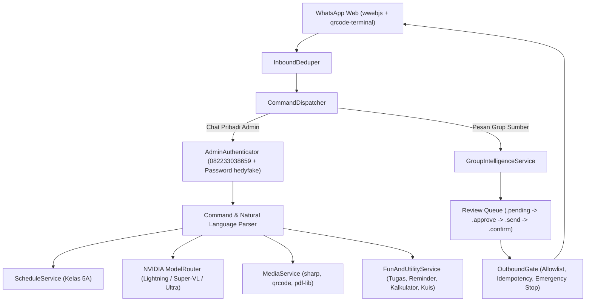

# ARSITEKTUR SISTEM HDYBOT (`docs/ARCHITECTURE.md`)

## 1. Gambaran Umum
HdyBot adalah asisten AI WhatsApp modular untuk **Nursing Class A (Semester 5A)** yang dikendalikan penuh melalui chat pribadi WhatsApp **Hedy** (`082233038659` / `+6282233038659`, verifikasi password `hedyfake`).

## 2. Struktur Direktori
- `start.js` & `ecosystem.config.cjs`: Entrypoint satu perintah untuk Node.js dan PM2 (`pm2 start start.js --name hdybot`).
- `install.sh`: Installer & runner otomatis 24/7 untuk Ubuntu Server.
- `src/config/env.ts`: Validasi environment berbasis Zod.
- `src/admin/`: Autentikasi nomor admin + password interaktif (`authenticator.ts`), one-time nonce (`confirmation.ts`), parser (`parser.ts`), dan dispatcher (`dispatcher.ts`).
- `src/ai/`: Integrasi NVIDIA API (`registry.ts`), router 3 model (`router.ts`), dan ekstraksi pesan grup (`group-intelligence.ts`).
- `src/modules/`:
  - `schedule/service.ts`: Jadwal kuliah 5A, zona waktu `Asia/Jakarta`, deteksi konflik istirahat `11:20–12:30`.
  - `reminders/scheduler.ts`: Penjadwalan pengingat H-1, 3j, 1j, 30m, mulai, dan selesai kuliah secara idempoten.
  - `materials/knowledge-base.ts`: Katalog materi & RAG berdasar sumber resmi.
  - `media/media-service.ts`: Pembuatan stiker WebP, stiker teks `.ttp`, `.toimg`, efek gambar, QR code, dan PDF DRAFT.
  - `fun/fun-utility-service.ts`: Manajemen tugas, pengingat kustom, catatan kelas, kalkulator, konversi satuan, cuaca, Wikipedia, dan hiburan aman.
- `prisma/`: Skema PostgreSQL (21 model), migrasi SQL, trigger audit append-only, dan seed data Semester 5A.
